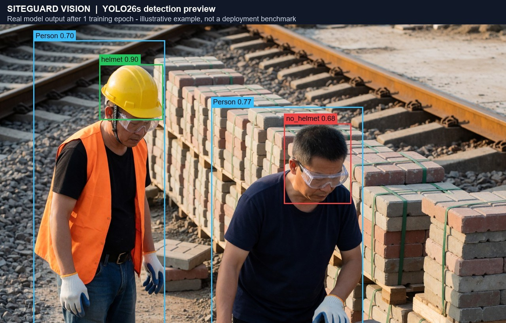

# siteguard-vision



*Actual model predictions after a one-epoch, 12-class Construction-PPE training smoke on RTX 5090. This selected image illustrates the project; it does not establish deployment accuracy. Image: Ultralytics Construction-PPE, CC BY 4.0; [attribution and provenance](docs/assets/README.md).*

Construction helmet analytics: MP4/RTSP → detector → ByteTrack → conservative head association → temporal confirmation → evidence, SQLite/PostgreSQL and an optional durable Kafka outbox. The processing backend and API run headlessly. An existing optional frontend prototype is included separately in `frontend/`; excavator analytics are outside this version.

**v0.1.0 status:** dataset integrity validation and genuine one-epoch CUDA training/inference have completed. Real recorded-video event evaluation is still pending. The frontend defaults to explicitly marked mock/demo data; its displayed events and charts are not model evaluation results. See [verification](docs/verification.md) for measured results and remaining limitations.

Prototype commands and dependencies are defined in [frontend/package.json](frontend/package.json).

A violation requires a **visible bare head associated with a tracked person**, repeated over source time. An absent helmet, occlusion, ambiguous association or tiny head stays UNKNOWN. Automated confirmation is separate from human review (`reviewstatus=pending`). This is an engineering implementation, not a certified safety system or a claim of detector accuracy.

## Install

Prefer Linux/WSL2 and Python 3.11. Install FFmpeg and a suitable NVIDIA host driver. The official [PyTorch installation commands](https://pytorch.org/get-started/previous-versions/) list stable `torch==2.14.1` / `torchvision==0.29.1` with CUDA 13.0; CUDA 12.8+ is required for RTX 5090. [PyTorch's Blackwell announcement](https://pytorch.org/blog/pytorch-2-7/) identifies CUDA 12.8 wheels as the initial supported path. Check guidance when upgrading; a local CUDA toolkit alone does not fix an incompatible torch wheel.

```bash
python3.11 -m venv .venv
source .venv/bin/activate
python -m pip install --upgrade pip
# RTX 5090; use the CPU index below for GPU-free tests instead.
python -m pip install torch==2.14.1 torchvision==0.29.1 --index-url https://download.pytorch.org/whl/cu130
python -m pip install -e '.[dev,ml]'
siteguard doctor
```

CPU installation:

```bash
python -m pip install torch==2.14.1 torchvision==0.29.1 --index-url https://download.pytorch.org/whl/cpu
python -m pip install -e '.[dev,ml]'
```

For the separately pinned CUDA 12.8 recovery profile, use torch 2.8.0 / torchvision
0.23.0 and `pip install -e '.[dev,ml-cu128]'`; do not combine the `ml` and
`ml-cu128` extras. The current local `.venv` uses this CUDA 12.8 pair recovered
from cache. Activate it before running `siteguard`. See the current
[P0 verification record](docs/verification.md) for the actual successful GPU
checks, real dataset/training results and outstanding video-evaluation limitations.

Core tests/API/data engineering can use `python -m pip install -e '.[dev]'` without torch. On Windows activate `.venv\Scripts\Activate.ps1`. `bash scripts/install.sh cpu|cuda` automates a fresh Linux environment. `doctor` checks compiled `sm_120`, memory and real FP32/FP16 CUDA operations, rather than trusting `is_available()`. `device: auto` falls back to CPU; an explicitly requested invalid GPU fails. Mixed precision is opt-in.

Runtime dependency versions and compatibility bounds are declared in `pyproject.toml`; experiment records capture the installed ML version and checkpoint hashes. A fully resolved, cross-platform lock was not generated in this network-restricted environment. After a clean successful install, save a platform-specific transitive freeze with `python scripts/lock_environment.py --output runs/requirements-linux-cu130.txt`; archive it with experiments and reinstall using the same torch index. Do not freeze an unrelated global environment.

## Dataset preparation (required before training)

Read [dataset engineering](docs/dataset.md) for license, semantic review and leakage gates. These commands use gitignored data locations:

```bash
siteguard dataset download --name construction-ppe
# Inspect actual extracted YAML, metadata and license, then adjust root/yaml_file in configs/datasets.yaml.
siteguard dataset validate --config configs/datasets.yaml
siteguard dataset report --config configs/datasets.yaml
# Review runs/annotation-samples/*.jpg and create fingerprint-bound data/reviews/*.json.
# Add real source provenance where available; unknown independence must be explicitly acknowledged.
siteguard dataset build --config configs/datasets.yaml
```

Validation writes `runs/dataset-report.json` even when inputs are missing or invalid. A successful integrity scan does **not** authorize unreviewed mappings. Build requires recorded sample review, permitted licensing, no detected cross-split leakage and explicit handling of unknown provenance. The official Construction-PPE train/validation partitions have no independent test set. Its mixed human-collected/generated provenance is retained. Counts and source class names are inspected rather than assumed.

Hard Hat Workers requires a versioned export and explicit license action, e.g. after downloading your selected version and inspecting its license:

```bash
siteguard dataset download --name hard-hat-workers --archive /path/to/versioned-export.zip \
  --version 13 --license-id Public-Domain --accept-license
```

`13` is an example selection, not a pinned recommended dataset version. Record your actual export version. A credentialed API path is also implemented; see the dataset guide. SHWD VOC conversion is available; its original `person` means a **negative head**, never a full person body. SH17 is excluded from the commercial pipeline.

## Train and validate

The verified [Ultralytics YOLO26 model names](https://docs.ultralytics.com/models/yolo26/) are `yolo26s.pt` and `yolo26m.pt`. The supported Ultralytics range is `>=8.4.0,<8.5.0`; version acceptance is separate from actual execution checks. Ultralytics 8.4.213 has passed a real CUDA training smoke here. Pretrained COCO checkpoints are initialization weights, **not PPE detectors**. Training is the only path that may acquire baseline weights automatically. Analysis requires an existing PPE checkpoint with all three configured concepts.

```bash
siteguard train --config configs/train.yaml
siteguard validate-model --model runs/train/stage-a-seed42/weights/best.pt \
  --data data/built/baseline-a-v1/data.yaml --split val --output runs/val-a
siteguard frame-diagnostics --data data/built/baseline-a-v1/data.yaml \
  --predictions runs/val-a/labels --output runs/fp-fn-a
siteguard export --model runs/train/stage-a-seed42/weights/best.pt --format onnx --device cpu
```

Configure epochs, batch, image size, device, workers, seed, AMP, augmentations, TensorBoard and resume in `configs/train.yaml`. Resume restores Ultralytics checkpoint arguments; `experiment.json` records the resolved arguments. Training writes best/last checkpoints, CSV metrics, configuration, data fingerprints and hardware metadata. Stage A uses Construction-PPE + YOLO26s; stage B adds only verified Hard Hat Workers training data and keeps the evaluation fingerprint identical. Compare YOLO26m after A/B. See [evaluation](docs/evaluation.md).

## Process MP4 or RTSP

```bash
siteguard analyze --input /path/to/site-recording.mp4 --output runs/demo \
  --model runs/train/stage-a-seed42/weights/best.pt --config configs/runtime.yaml
# CPU override is useful for verification:
siteguard analyze --input /path/to/site-recording.mp4 --output runs/cpu-demo \
  --model runs/train/stage-a-seed42/weights/best.pt --device cpu
# Put the private URL in the environment; avoid command history/process-list exposure.
export SITEGUARD_RTSP_SOURCE='rtsp://...'
siteguard stream --camera-id cam01 --output runs/cam01 --config configs/runtime.yaml
siteguard benchmark --input /path/to/site-recording.mp4 \
  --model runs/train/stage-a-seed42/weights/best.pt --output runs/benchmark.json
```

Each new analysis output directory contains `annotated.mp4`, timestamped `frames.jsonl`, lifecycle snapshots in `events.jsonl`, saved confirmation images in `evidence/`, `metrics.json` and the compatible `summary.json`. SQLite defaults to `runs/siteguard.sqlite`. JSONL may contain multiple snapshots of the same `eventid`; keep the last snapshot for final-state evaluation. The API has one current row per event. File frame loss is never silently tolerated: sampled frames block on a bounded queue; detected early decode termination raises an error. Intentional FPS sampling and live queue drops have separate counters.

MP4 output contains sampled frames at CFR and no audio; it is an inspection artifact. `frames.jsonl` preserves actual source timestamps, including VFR/jitter. RTSP reconnects, timestamp discontinuities, long gaps and detected camera cuts reset tracking/rules. OpenCV cannot guarantee camera-origin NTP timestamps or detect every camera cut; timestamp fallbacks are labeled. See [architecture](docs/architecture.md) and [deployment](docs/deployment.md).

## Headless API and optional services

```bash
export SITEGUARD_API_TOKEN="$(python -c 'import secrets; print(secrets.token_urlsafe(32))')"
siteguard serve
curl -H "Authorization: Bearer $SITEGUARD_API_TOKEN" 'http://127.0.0.1:8000/events?limit=20&offset=0'
```

`GET /health` is liveness only. `/ready`, `/cameras`, `/events`, `/events/{eventid}` and `/metrics` require the token. Readiness covers the API/database; camera heartbeats expose worker state. No public evidence-serving, interactive API docs or viewing routes are provided. `SITEGUARD_DATABASE_URL=postgresql://...` plus `pip install -e '.[postgres]'` selects PostgreSQL. Never place credentials in committed YAML.

Kafka is off by default. Enable `kafka_enabled: true` to write outbox rows atomically with events, then run the separate publisher:

```bash
python -m pip install -e '.[kafka]'
docker compose -f docker/compose.yaml --profile kafka up -d kafka
export SITEGUARD_KAFKA_BOOTSTRAP_SERVERS=localhost:9092
siteguard publish-outbox
# Schedule repeated invocations; exhausted attempts remain visible as dead records.
siteguard publish-outbox --replay-dead
siteguard cleanup --retention-days 30 --evidence-root runs
```

Only compact confirmation metadata and evidence references are published. Publication is at least once; consumers deduplicate by event ID. See [architecture](docs/architecture.md) and [consumer example](examples/kafka_consumer.py). Evidence retention skips open events and undelivered outbox records.

## Tests and verification

```bash
python scripts/check.py
# Or individually:
python -m pytest -q
python -m ruff check src tests scripts examples
python -m mypy
python scripts/generate_fixture.py --output examples/synthetic.mp4
# Genuine optional GPU smoke; supply trained canonical PPE weights:
SITEGUARD_GPU_MODEL=/path/to/best.pt python -m pytest -m gpu -q
```

Synthetic fixtures and fake detector/tracker implementations exist **only in tests**. The CLI never substitutes them for a real detector. GPU-free CI checks core rules/storage/evaluation/API, with a separate CPU ByteTrack adapter job. Detailed measured status and reproducible next steps are in [verification](docs/verification.md). No trained accuracy, end-to-end alert quality, independent video performance or throughput is claimed without labeled recordings and saved real checkpoints.

Review [licensing](docs/licensing.md) before commercial deployment: dataset licensing and Ultralytics AGPL/Enterprise obligations are separate.
