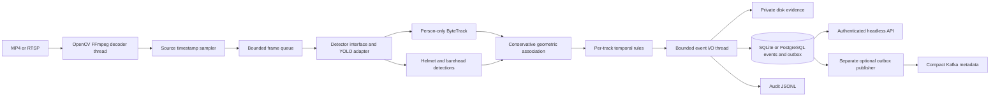

# Architecture and operational invariants

The modular monolith owns one video decoder, detector, tracker and rules engine per worker process. Decode and event I/O use bounded threads. Inference and tracking stay ordered on the main thread. Use separate processes for cameras; FFmpeg transport settings and Ultralytics settings are process-global. There is no raw-frame broker transport. Process supervision, worker count and GPU allocation are deployment responsibilities.

## Time and backpressure

Each frame carries camera ID, decoder session, index, source timestamp, decode UTC, decode monotonic time and timestamp basis. Offline POS_MSEC is preferred; frame-index/FPS fallback is explicit. RTSP uses decoder PTS when usable, otherwise receive-monotonic session time. These are not guaranteed absolute camera UTC. A future GStreamer/DeepStream reader should emit the same frame contract with a true source-clock basis.

The sampler schedules by elapsed source time, avoiding frame-count assumptions. Offline queue puts block, while live queues explicitly drop oldest (default) or newest. Metrics distinguish decoded, sampled, intentionally skipped and queue-dropped frames. Reconnection discards stale queued frames and starts a new session. Retries have a capped backoff and lifetime budget. Read/open timeouts bound cooperative shutdown. A native decoder that ignores timeouts raises a shutdown error; use a supervised subprocess if stronger kill isolation is required.

Source timestamps, rather than wall-clock processing speed, drive temporal rules. A gap longer than the tracking retention resets identities. Grayscale histogram distance detects abrupt scene changes conservatively; it cannot detect every cut, especially visually similar views. Camera controls should also restart the worker after deliberate view changes.

## Association and UNKNOWN

Only person detections go through ByteTrack. Candidate head boxes must fit mostly inside the upper 40% of a person box (allowing a small top margin), have a center in the upper 38%, and be smaller than configured body-relative limits. Scores combine containment and distance from the expected head position. A head is assigned once, only when its best candidate exceeds the runner-up by an ambiguity margin. Similar overlapping people, conflicting helmet/barehead evidence, small/clipped heads, low person confidence and no visible head yield UNKNOWN. These thresholds are intentionally conservative and need validation for each camera viewpoint.

The rules interface is independent of detector and tracker libraries. It supports UNKNOWN → COMPLIANT or SUSPECT → CONFIRMED → CLEARED. A sliding window requires both a minimum observation count and minimum elapsed duration, with a maximum supporting gap. A missing observation never counts as barehead support. A confirmed incident keeps its ID through short unknown intervals; sustained visible helmets clear it. Long evidence loss ends it without claiming compliance. Cooldown suppresses repeat incidents within the same track. Reconnects/cuts use a new scope and do not carry cooldown across unrelated identities.

Track IDs are meaningful only with `cameraid + streamsessionid`. IDs can change after occlusion; this implementation does not claim reliable cross-occlusion re-identification. Geometric matching and temporal filtering reduce some false alerts but do not prove human identity. Duplicate rates must be measured on labeled site videos.

## Persistence and recovery

An event has source-relative onset/end/confirmation times, model checkpoint hash, confidence summary, observation count, bounded onset/recent supporting samples, evidence paths and independent review status. Up to 128 detailed observations are retained, while total support count and mean/min/max continue updating. Confirmation writes the original full frame, atomically renames it, commits metadata, then appends a JSONL snapshot. The frame log contains box associations and processing times. No built-in human review UI or review mutation API is provided.

Evidence paths hash camera/session/event components. Full frames are private operational data; protect the run directory. A crash between evidence save and SQL commit may leave an orphan image; a crash after SQL commit and before JSONL append can leave a missing JSONL snapshot. The database is authoritative. Active rows left by a killed worker stay confirmed/open; reconcile them against the recording/frame log before retention or final evaluation. Evidence video paths are optional and currently null; automatic pre/post incident clip extraction is not implemented.

SQLite WAL uses full synchronous commits and short connections. PostgreSQL uses the same parameterized persistence interface via psycopg. Schema version 1 is checked; future schema changes need explicit migrations. Back up both database and evidence. Cleanup handles closed events only and refuses evidence paths outside its configured root. Frame logs, annotated MP4s and orphan files need a separate filesystem retention policy; event cleanup deliberately does not delete entire run directories.

## Kafka guarantees

When enabled, the initial confirmed event and outbox record commit in the same transaction. The worker never waits for the broker. A single publisher per database drains bounded batches, waits for delivery callbacks, records bounded retries with exponential delays and exposes exhausted attempts as `dead`. Run it periodically under a supervisor. Explicit replay requeues dead records. `/metrics` reports state counts. Delivery failures do not erase event rows.

A crash after broker acknowledgement but before marking the row delivered can republish an event. This is **at-least-once**, with eventid-based consumer idempotency. Kafka producer idempotence helps in-session broker retries, not end-to-end exactly-once delivery. Multiple publishers are safe only with consumer deduplication; no multi-publisher lease or ordering guarantee is implemented. The broker snapshot is the initial confirmation; later clearance, final observation counts and human review updates are available from SQL/API, not automatically republished.

## Metrics

Analysis records processed FPS, source FPS, explicit sampling/drop counters and decode-to-output latency percentiles over the last 2,048 processed frames. Total sample counts are retained. Latency excludes camera capture/network delay and asynchronous durable event commit latency. `diagnostics.json` aggregates real association rejection reasons, confidence histograms, state observations and lifecycle/reset counters. Frame JSONL includes compact per-frame diagnostics. Independent timers measure decoder, inference, tracking, association, temporal rules, render/encode, evidence and database I/O. Each timer has bounded 2,048-sample storage; concurrent stage totals overlap. GPU allocator readings are process-scoped. Failed worker-loop runs also persist reports and attempt every cleanup. Benchmark measures detector-only FP32/FP16 inference separately and samples GPU memory/utilization with nvidia-smi where available. It must not be described as an end-to-end service benchmark. Accuracy fields remain null without real ground truth.
